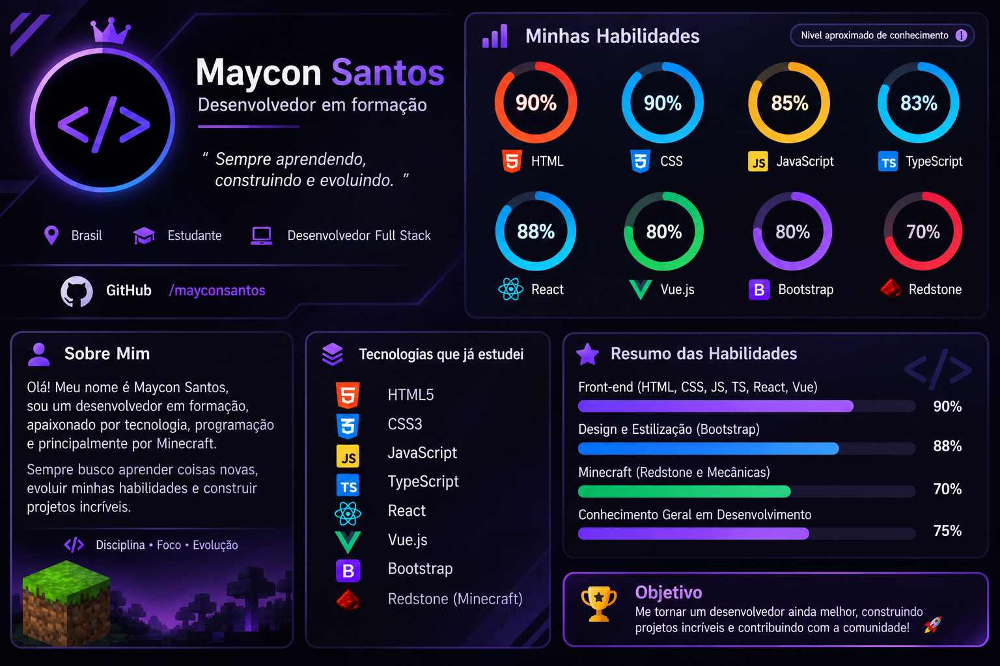

### Olá! Meu nome é Maycon Santos
Eu sou desenvolvedor em formação 👋

Sou um desenvolvedor em constante aprendizado, interessado em tecnologia e desenvolvimento de software. Tenho conhecimentos em desenvolvimento Front-end e Back-end, buscando aprimorar minhas habilidades e construir aplicações cada vez mais completas.

💻 Tecnologias e conhecimentos

Front-end: HTML, React, Vue.js, Bootstrap e TypeScript.

Back-end: Conhecimentos básicos em desenvolvimento Back-end.

Banco de dados: MongoDB (conhecimentos básicos).

Outros: JavaScript e desenvolvimento de interfaces web.

🚀 Objetivos

Estou sempre buscando aprender novas tecnologias, desenvolver projetos práticos e aprimorar minhas habilidades em programação, com foco no desenvolvimento Web e na construção de soluções eficientes.

- 💭 O verdadeiro conhecimento não está em saber todas as respostas, mas em nunca perder a curiosidade de questionar o mundo.
 

  <a href="https://github.com/Mayconsrc">
  
  

